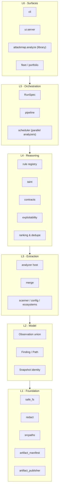
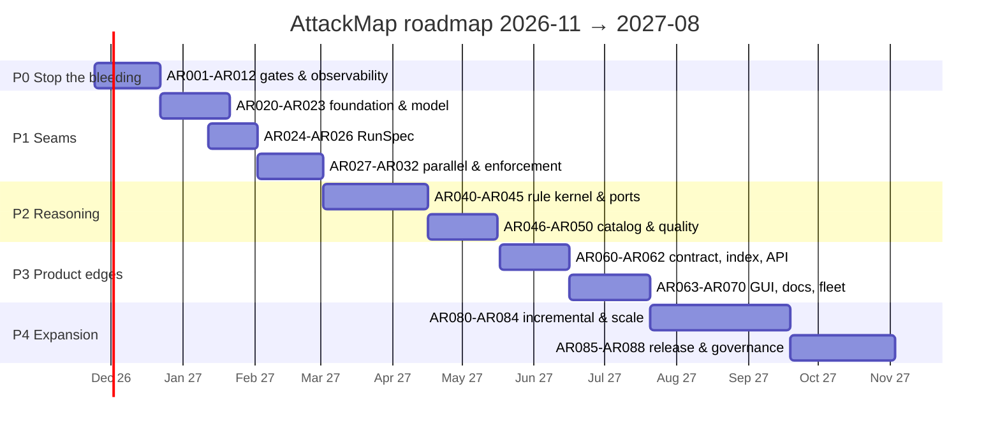

# AttackMap — Product & Architecture Roadmap

**Plan date:** 2026-11-21 · **Baseline:** `HEAD 5ee4d20` · **Status:** PROPOSED
**Owner:** repository owner · **Executable detail:** [`todo.md`](todo.md) · **Gates:** [`criteria.md`](criteria.md)

---

## 1. Thesis

AttackMap already has the hard part: real domain insight, an evidence-first doctrine, a
transactional artifact model, and a plugin platform that most commercial tools never
reach. What it does not have is the **structure that lets that insight compound**.

Three sentences define this roadmap:

1. **Stop the drift** so that every later change is measurable.
2. **Turn the five exemplary patterns into the default** so the other 95% of the
   codebase stops fighting itself.
3. **Convert encoded knowledge into data** so detection quality becomes a number the
   project can improve instead of a claim it asserts.

The roadmap is therefore not a rewrite. It is a **migration toward the standard the
codebase already demonstrated in five places**.

### 1.1 What "better" means, concretely

| Dimension | Today | Target | Why the user cares |
| --- | --- | --- | --- |
| Time to re-scan a 10k-file repo after 50 edits | full re-scan (minutes) | **< 10 s** | makes pre-commit and watch mode viable |
| Analyzer wall time on a reference repo | serial baseline | **≥ 2.5× faster** | monorepos become analysable |
| Detections with a stable ID, CWE, rationale | none | **≥ 40 rules, 100% with IDs** | findings become discussable and trackable |
| Per-rule precision/recall | unknown | **published per release** | trust replaces vibes |
| New import cycles per quarter | 44 and growing | **0** | architecture stops decaying |
| Time for a new contributor to run a scan | hours (docs maze) | **< 10 minutes** | community and hiring |
| Programmatic use | CLI only | **5-line Python API** | CI, IDE, portfolio tooling |
| Cross-run questions ("what changed?") | manual JSON diff | **SQLite index + `trends`** | weekly security review becomes real |
| GUI state load on 50 generations | full re-read | **< 200 ms** | the desktop app feels like a product |

### 1.2 What this roadmap deliberately does *not* do

- It does not add a database as a source of truth. Generations stay authoritative; the
  index is a disposable projection.
- It does not introduce microservices, a message broker, or a container runtime.
  AttackMap is local-first by design and that is a feature.
- It does not replace the heuristic engine with an LLM. The LLM narrates and triages;
  deterministic code decides.
- It does not reopen, re-scope, or close any `WP001`–`WP044` task.

---

## 2. Target architecture

### 2.1 Layering (strict, downward-only)



**Rule:** a layer may import only strictly lower layers. Enforced by
`tests/architecture/test_import_boundaries.py` (AR002/AR031), not by convention.

### 2.2 Execution pipeline (target)

```mermaid
flowchart LR
    A["RunSpec"] --> B["index snapshot<br/>one walk, one read"]
    B --> C{"scheduler"}
    C -->|"isolated"| D1["analyzer host #1"]
    C -->|"isolated"| D2["analyzer host #2"]
    C -->|"in-process"| D3["built-in analyzers"]
    D1 --> E["merge (declarative schema)"]
    D2 --> E
    D3 --> E
    E --> F["whole-repo passes<br/>cancellable, budget-aware"]
    F --> G["reasoning: rules → findings → paths"]
    G --> H["rank & dedupe (single policy module)"]
    H --> I["EvidenceBundle (versioned)"]
    I --> J["render: MD / JSON / SARIF / diagrams"]
    I --> K["AI layer (optional)"]
    K --> L["citation validation"]
    J --> M["immutable generation"]
    L --> M
    M --> N["atomic pointer swap"]
    N --> O["derived SQLite index"]
```



### 2.3 Repository shape (target)

```
src/attackmap/
  foundation/      safe_fs, redact, srcpaths, artifact_manifest, artifact_publisher
  model/           observations, findings, paths, snapshot, evidence_bundle
  extraction/      merge, analyzer_host, scanner, config_scanner, ecosystems/*
  reasoning/       rules/*, taint, contracts, exploitability, ranking
  orchestration/   run_spec, pipeline, scheduler, fleet, portfolio
  output/          report, sarif, diagrams, defensive_review, export
  ai/              providers, prompts, budget, citations, harness
  surfaces/        cli, ui, library
  sdk/             public plugin contract (unchanged import path)
```

`attackmap.sdk` keeps its current import path and stability promise. Everything else is
free to move, because `sdk/` is the only promised surface.

---

## 3. Phases

Five phases. Each has a **capability outcome** (what a user can do that they could not
before) and a **hard exit gate** (what must be measured before the phase closes).

### Phase 0 — Stop the bleeding (3–4 weeks)

**Capability outcome:** the project can no longer decay silently. Every future change is
linted, typed, timed, cycle-checked, and observable.

**Work:** AR001–AR012.

| Theme | Tasks |
| --- | --- |
| Static gates | AR001 ruff + mypy + xdist + timeout + coverage |
| Architecture guard | AR002 boundary test with 44-cycle allowlist |
| Observability | AR003 per-run `events.jsonl` |
| Consistency | AR004 unified policy constants (fixes divergent skip-dirs/severity maps) |
| Encoding integrity | AR005 `.gitattributes` + U+FFFD CI check + repair |
| Secure defaults | AR006 trusted-analyzers-by-default |
| Budget honesty | AR007 intra-stage cancellation checkpoints |
| Test shape | AR008 `unit/integration/contract/live` split + markers |
| Ratchets | AR009 baseline + ratchet config |
| CI shape | AR010 fast/full/live pipeline split |
| Self supply chain | AR011 `pip-audit` + release SBOM |
| Failure transparency | AR012 typed error taxonomy, replace broad excepts |

**Exit gate:** AC-001 … AC-013 all pass; CI rejects any new import cycle; fast suite
under 5 minutes.

**Explicit non-goal:** no behavioural change to any scan. If a report diff appears in
Phase 0, it is a bug.

---

### Phase 1 — Create the seams (6–8 weeks)

**Capability outcome:** the engine becomes embeddable and parallel. A 24-analyzer scan
runs in a fraction of the time, and a single option object describes a run.

**Work:** AR020–AR032.

| Theme | Tasks |
| --- | --- |
| Foundation de-cycling | AR020 `safe_fs ↔ artifact_manifest`, AR021 delete `recon_models` shim |
| Model split | AR022 `model/` package, AR023 ledger out of `models` |
| Configuration | AR024 `RunSpec`, AR025 retire `AnalyzeOptions`, AR026 remove ambient flags |
| Throughput | AR027 parallel analyzers, AR028 thread-safe progress/budget |
| Package shape | AR029 subpackage restructure |
| Enforcement | AR030 allowlist → 0, AR031 per-layer import rules |
| Contracts | AR032 SDK/merge/artifact compatibility tests |

**Exit gate:** AC-101 … AC-111; cycle allowlist empty; `models` fan-in ≤ 25; analyzer
wall time ≥ 2.5× faster; **byte-identical report output** on the regression corpus
versus the Phase 0 baseline.

**Risk note:** AR022/AR029 touch nearly every file. Mitigation: mechanical moves only,
`git mv` + re-export shims for one release, and the byte-identical report gate.

---

### Phase 2 — Turn knowledge into data (8–10 weeks)

**Capability outcome:** AttackMap can state exactly what it detects, and the project can
measure whether each detection is getting better.

**Work:** AR040–AR050.

| Theme | Tasks |
| --- | --- |
| Rule kernel | AR040 `ReasoningContext` + `Rule`/`RuleMeta` + registry |
| Rule porting | AR041 route/auth, AR042 datastore/edge, AR043 secrets/config, AR044 taint/flow, AR045 supply-chain/workflow |
| Discoverability | AR046 `attackmap rules list --json` + generated docs |
| Testing | AR047 per-rule test harness |
| Measurement | AR048 detection quality harness (precision/recall per rule) |
| Explainability | AR049 rationale + evidence chain shipped in every finding |
| Policy | AR050 single ranking/dedupe module |

**Exit gate:** AC-201 … AC-208; ≥ 40 rules with stable IDs; every rule has a focused
test; `generate_findings` ≤ 60 lines; a published per-rule precision/recall baseline.

**Why this is the pivot:** after Phase 2, "we use heuristics" becomes "we have 47 rules,
here is the measured precision of each, here is what changed this release." That is the
difference between a demo and a product.

---

### Phase 3 — Harden the product edges (8 weeks)

**Capability outcome:** AttackMap becomes embeddable, queryable, and pleasant to use.

**Work:** AR060–AR070.

| Theme | Tasks |
| --- | --- |
| Plugin contract v2 | AR060 `ExtractionResult` union + v1 adapter |
| Queryability | AR061 derived SQLite index, `index rebuild`, `trends` |
| Embedding | AR062 `attackmap.analyze()` library API |
| GUI server | AR063 decompose `ui/server.py`, AR064 dialog dispatcher |
| GUI client | AR065 ES modules + typed client, AR066 PDF behind protocol |
| AI boundary | AR067 versioned `EvidenceBundle` |
| Docs | AR068 archive logs, generated reference, 10-minute onboarding |
| Fleet parity | AR069 close the 10-flag gap |
| GUI performance | AR070 state load < 200 ms |

**Exit gate:** AC-301 … AC-312.

**Sequencing note:** AR063/AR064/AR065 must be coordinated with the current Windows
surface owner. If a `WP` task owns `src/attackmap/ui/**` at the time, Phase 3 GUI work
waits; AR060/AR061/AR062/AR067/AR069 can proceed independently.

---

### Phase 4 — Expansion (3–4 quarters)

**Capability outcome:** AttackMap becomes a platform — fast enough for watch mode, broad
enough for portfolios, trustworthy enough for release engineering.

**Work:** AR080–AR088.

| Theme | Tasks |
| --- | --- |
| Incrementality | AR080 content-addressed store |
| Scale | AR081 portfolio mode |
| Ecosystem | AR082 official analyzers on SDK v2 |
| Operability | AR083 metrics + trace ids + GUI activity feed |
| Performance governance | AR084 perf regression suite |
| Release engineering | AR085 reproducible builds, SBOM, attestation |
| Adversarial robustness | AR086 hostile-input corpus + fuzzing |
| Contribution | AR087 rule authoring guide + template |
| Decision hygiene | AR088 ADR index + architecture drift dashboard |

**Exit gate:** AC-401 … AC-409.

---

## 4. Capability milestones

The roadmap is organized by phase, but users experience **capabilities**. These are the
externally visible checkpoints.

| Milestone | After | User-visible statement |
| --- | --- | --- |
| **M-A · Trustworthy CI** | Phase 0 | "A bad patch cannot land unnoticed." |
| **M-B · Fast engine** | Phase 1 | "A large repo scans in a fraction of the time, and the output is identical." |
| **M-C · Accountable detection** | Phase 2 | "Every finding has an ID, a rationale, and a measured precision." |
| **M-D · Embeddable product** | Phase 3 | "I can call it from Python, query history, and the desktop app opens instantly." |
| **M-E · Platform** | Phase 4 | "It runs in watch mode, across a portfolio, and its releases are reproducible." |

---

## 5. Sequencing and dependencies



### Hard dependency chains

```
AR001 → AR002 → AR030 → AR031
AR004 → AR022 → AR029
AR020 → AR022 → AR023 → AR024 → AR025 → AR026
AR024 → AR027 → AR028
AR040 → AR041..AR045 → AR046 → AR047 → AR048
AR022 → AR060          (model must be split before the union lands)
AR024 → AR062          (library API needs a single request object)
AR061 → AR070          (GUI speed needs the index)
AR080 → AC-401         (10 s re-scan needs CAS)
```

### Parallelism rules

- Phase 0 tasks are almost fully parallel except AR002 → AR030.
- Phase 1: AR020–AR023 are one serial chain; AR024–AR026 are a second chain; AR027–AR028
  are a third. Three agents can work concurrently.
- Phase 2: each rule family (AR041–AR045) is independent once AR040 lands. Five agents.
- Phase 3: AR060/AR061/AR062/AR067/AR069 independent; AR063→AR064→AR065 serial;
  AR068/AR070 independent.
- Phase 4: AR080 and AR081 conflict on the index schema — serialize them.

---

## 6. Quality gates and KPIs

### 6.1 Gates (must hold at every phase boundary)

| Gate | Threshold | Verified by |
| --- | --- | --- |
| Lint | `ruff check` clean at ratchet baseline | AR001, AC-001 |
| Types | `mypy` no new errors | AR001, AC-002 |
| Cycles | 0 | AR002/AR030, AC-005/AC-109 |
| Fast suite | < 5 min, `-n auto`, 120 s timeout | AR001/AR010, AC-003 |
| Coverage | never decreases | AR009, AC-004 |
| Report identity | byte-identical on regression corpus | AR032, AC-111 |
| Budget honesty | cancellation within 5 s of expiry | AR007, AC-010 |
| Encoding | 0 U+FFFD in source/prompts | AR005, AC-008 |

### 6.2 KPIs tracked per release

| KPI | Baseline | Target | Phase |
| --- | --- | --- | --- |
| Analyzer wall time (reference repo) | serial | ≥ 2.5× faster | 1 |
| 10k-file re-scan, 50 changed | full scan | < 10 s | 4 |
| Rules with stable ID | 0 | ≥ 40 | 2 |
| Rules with a focused test | 0 | 100% | 2 |
| Per-rule precision/recall published | no | yes | 2 |
| `generate_findings` length | 787 | ≤ 60 | 2 |
| Import cycles | 44 | 0 | 1 |
| `models` fan-in | 64 | ≤ 25 | 1 |
| Broad `except Exception` | 62 | ≤ 15 | 0/4 |
| Modules using `logging`/structured events | 3 | 100% of stages | 0/4 |
| GUI state load (50 generations) | full read | < 200 ms | 3 |
| `/api` endpoints with schema | 0/13 | 13/13 | 3 |
| Onboarding time | hours | < 10 min | 3 |

### 6.3 Anti-goals (explicitly not measured, not pursued)

- Lines of code reduced. Refactors here are about **shape**, not size.
- Test count increased. The target is test **signal**, and the count may fall as
  duplicated whole-scan assertions are replaced by rule-level tests.
- New analyzers. Phase 0–3 add none; the ecosystem grows in Phase 4 on a stable contract.

---

## 7. Risks and mitigations

| # | Risk | Likelihood | Impact | Mitigation |
| --- | --- | --- | --- | --- |
| R1 | Phase 1 restructure breaks the Windows build | Medium | High | AR032 byte-identical report gate; coordinate with WP owner; keep `sdk/` path stable |
| R2 | Rule porting changes findings | High | High | Port rule-by-rule with a frozen-output diff harness; ship both paths behind a flag until parity |
| R3 | Parallel analyzers introduce nondeterminism | Medium | High | Deterministic merge order by `(priority, name)`; AR028; serial-vs-parallel equivalence test |
| R4 | Static gates generate a wall of pre-existing debt | High | Medium | Ratchet baselines in AR009, not a big-bang cleanup |
| R5 | Docs plan itself becomes rot | Medium | Medium | Four living docs, no dated append-only paragraphs, owner promotes or drops |
| R6 | SQLite index drifts from generations | Medium | Medium | Index is disposable; `index rebuild` is a required acceptance test (AC-302/AC-303) |
| R7 | Scope creep into product features | High | Medium | Anti-goals in §6.3; new analyzers deferred to Phase 4 |
| R8 | Solo-maintainer bandwidth | High | High | Parallelism rules in §5; phases are independently valuable, stop-anywhere safe |

**Stop-anywhere property:** every phase leaves the product strictly better and fully
shippable. There is no phase whose partial completion makes the tool worse.

---

## 8. Alternatives considered and rejected

| Decision | Chosen | Rejected | Why |
| --- | --- | --- | --- |
| Structural style | Modular monolith, enforced layers | Microservices | No server, no multi-tenant; ops cost with zero benefit |
| Persistence | Generations + disposable SQLite projection | Postgres / document DB | Breaks local-first; new source of truth |
| Analyzer execution | Process pool, isolated by default | Threads only | GIL makes threads a non-answer for parsing |
| Plugin contract | Discriminated union with v1 adapter | Keep 33-field aggregate | Blocks every extension |
| Reasoning | Rule registry (data) | Refactor the cascade in place | Cascade cannot be measured or documented |
| Config | Single immutable `RunSpec` | DI container | Over-engineered for a CLI |
| Frontend | No-build ES modules | React/Vite | Preserves dependency discipline; WebView2 supports ESM |
| AI role | Narrator over a versioned `EvidenceBundle` | AI decides findings | Violates evidence-first doctrine |

---

## 9. Definition of done for the whole plan

The roadmap is complete when all of the following are true:

1. `ruff`, `mypy`, and coverage ratchets are green and enforced in CI.
2. `tests/architecture/` proves zero cycles and correct layer direction.
3. `attackmap.rules` exposes ≥ 40 rules with IDs, CWEs, rationales, and per-rule tests.
4. A published per-rule precision/recall report exists for the reference corpus.
5. `attackmap.analyze(RunSpec(...))` works in five lines from a Python script.
6. `attackmap index rebuild` reconstructs a queryable index from generations alone.
7. A 10k-file repo re-scans 50 changed files in under 10 seconds.
8. The GUI loads 50 generations of state in under 200 ms.
9. `events.jsonl` in every generation explains what ran, what was skipped, and why.
10. A new contributor runs a successful scan in under ten minutes using one document.

---

## 10. First week (concrete)

If work starts tomorrow, this is the sequence:

| Day | Action | Task |
| --- | --- | --- |
| 1 | Add `ruff`, `mypy`, `pytest-xdist`, `pytest-timeout`, `pytest-cov`; wire CI | AR001 |
| 2 | Add architecture boundary test with the 44-cycle allowlist; confirm it fails on a synthetic new cycle | AR002 |
| 3 | Capture ratchet baselines (lint count, type errors, coverage, cycle count) | AR009 |
| 4 | Unify severity/skip-dir constants; run full suite; inspect any report diff | AR004 |
| 5 | Add `events.jsonl` emission at stage boundaries and analyzer start/end | AR003 |
| 6 | Repair encoding, add `.gitattributes`, add U+FFFD CI check | AR005 |
| 7 | Invert the analyzer trust default; document the new flag | AR006 |

By day seven the project has a safety net, a measurement baseline, and an audit trail.
Everything after that is a migration that the safety net protects.
