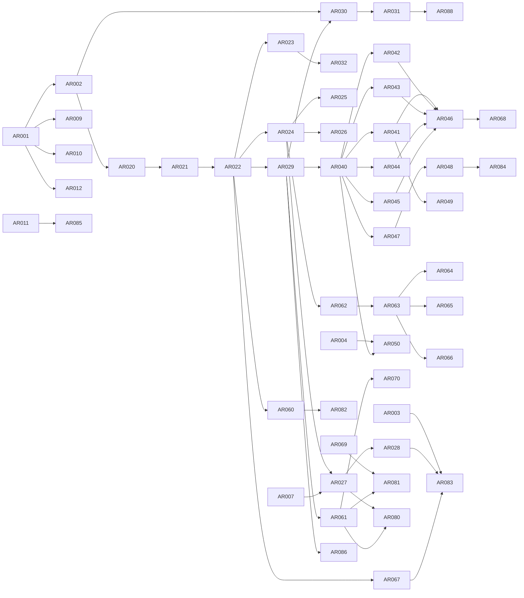

# Executable TODO — Architecture & Product Roadmap 2026-11-21

**56 tasks: `AR001`–`AR088`.** Each card is self-contained: scope, files, steps,
acceptance, verification, rollback.

## How to use this document

1. Pick the lowest-id task in the current phase whose **Depends** are all `DONE`.
2. Check the **Lease** key against `backlog.json` → `active_leases`. Two tasks with the
   same lease key must not run concurrently.
3. Implement only the listed **Files**. Anything else is a new task.
4. Run **Verify** exactly as written and attach the output.
5. Set status to `DONE` here and in `backlog.json`. Do not add dated prose.

## Status legend

`OPEN` · `IN_PROGRESS` · `BLOCKED` · `DONE` · `DEFERRED`

All tasks below start as **OPEN**.

## Common verification commands

```bash
# fast suite
pytest -m "unit or contract" -n auto --timeout=120

# full suite
pytest -m "not live" -n auto --timeout=300

# architecture report
python -m tools.arch_report --cycles --fan-in --broad-excepts --json

# report identity gate (Phase 1+)
python -m tools.report_identity --corpus tests/fixtures/regression.yaml
```

## Card schema

```
### ARxxx · Title
**Phase** · **Priority** · **Effort** · **Depends** · **Blocks**
**Lease** · **Acceptance**

**Files** — exact paths
**Steps** — ordered, mechanical where possible
**Verify** — copy-pasteable command(s)
**Rollback** — how to undo safely
```

---

# Phase 0 — Stop the bleeding

### AR001 · Static analysis gates
**Phase** 0 · **Priority** High · **Effort** 0.5 d · **Depends** — · **Blocks** AR002, AR009, AR010
**Lease** `ci-config` · **Acceptance** AC-001, AC-002, AC-003, AC-004
**Status** DONE (commit 9e5c01a) — ruff/mypy/pytest config + CI lint/types/test-fast; baseline debt recorded by AR009

**Files** `pyproject.toml`, `.github/workflows/ci.yml`

**Steps**
1. Add `ruff`, `mypy`, `pytest-xdist`, `pytest-timeout`, `pytest-cov` to the dev extra.
2. Configure `[tool.ruff]` with `select = ["E","F","I","B","UP","SIM","RUF"]`,
   `line-length = 100`, `target-version = "py311"`.
3. Configure `[tool.mypy]` with `python_version = "3.11"`,
   `check_untyped_defs = true`, `ignore_missing_imports = true`.
4. Add `[tool.pytest.ini_options]` `addopts = "-q --strict-markers"` and register
   markers `unit, integration, contract, live, perf`.
5. Add CI jobs `lint`, `types`, `test-fast`; keep the existing 3×3 matrix as `test-full`.

**Verify** `ruff check . && mypy src/attackmap && pytest -m "unit or contract" -n auto --timeout=120`

**Rollback** Revert both files. No source change, no behaviour change.

---

### AR002 · Architecture boundary test with cycle allowlist
**Phase** 0 · **Priority** High · **Effort** 0.5 d · **Depends** AR001 · **Blocks** AR030, AR031
**Lease** `tests-arch` · **Acceptance** AC-005
**Status** DONE — `tools/arch_report.py` (AST imports, cycles/fan-in/fan-out/broad-excepts/functions), `tests/architecture/test_import_boundaries.py` (no new cycles, no stale entries, length capped), `cycle_allowlist.json` frozen at 49 canonical cycles (review's 44 used different tooling; gate is "never grows"); negative proof: planted `srcpaths → index` cycle failed the gate, then reverted

**Files** `tests/architecture/test_import_boundaries.py`, `tests/architecture/cycle_allowlist.json`, `tools/arch_report.py`

**Steps**
1. Write `tools/arch_report.py` that parses imports via AST (handling relative imports)
   and emits cycles, fan-in, fan-out, broad-except counts as JSON.
2. Generate the current cycle set and write it to `cycle_allowlist.json` (44 entries).
3. Write the test: recompute cycles, assert `set(cycles) - allowlist == ∅`, and assert
   `len(allowlist)` never grows.
4. Add a self-test proving a synthetic cycle is detected.

**Verify** `pytest tests/architecture/ -v && python -m tools.arch_report --cycles --json`

**Rollback** Delete the three files. Test-only, no runtime impact.

---

### AR003 · Structured run event log
**Phase** 0 · **Priority** High · **Effort** 1 d · **Depends** AR001 · **Blocks** AR083
**Lease** `progress` · **Acceptance** AC-006
**Status** DONE — `EventLog` in `progress.py`; stage start/end/skip emitted from `_diagnostic_phase` + `_deadline_hit`; analyzer start/end/error emitted from `analyze_repository(events=…)`; `events.jsonl` flushed into the generation dir before the pointer swap; live AC-006 snippet passed (19 records, 7 stages, 3 analyzers). Note: the `publication` stage legitimately records only `start` — the log is finalized by the commit it triggers

**Files** `src/attackmap/progress.py`, `src/attackmap/pipeline.py`, `src/attackmap/artifact_publisher.py`

**Steps**
1. Add `EventLog` writing JSONL with `ts, run_id, trace_id, stage, event, status, ms, detail`.
2. Emit `stage start/end/skip` from `pipeline._run_scan` and `analyzer start/end` from
   `analyzers.analyze_repository`.
3. Persist `events.jsonl` inside the generation directory **before** the pointer swap so
   a published generation always has its log.
4. Keep stdout progress unchanged; the event log is additive.

**Verify** Run a scan, then the AC-006 snippet.

**Rollback** Delete `events.jsonl` emission; progress output is untouched.

---

### AR004 · Unify policy constants
**Phase** 0 · **Priority** High · **Effort** 1 d · **Depends** AR001 · **Blocks** AR050
**Lease** `core-policy` · **Acceptance** AC-007
**Status** DONE — new `src/attackmap/policy/` (constants with per-constant divergence notes); SEVERITY_RANK (3 copies), SEVERITY_ORDER (threat_model inverse map kept explicit), SKIP_DIRS union (6 variants → 1, incl. suggest's private `.vscode`/`.mypy_cache`/`.pytest_cache`), LOW_QUALITY_SEGMENTS union (5 copies, 2 shapes → 7-segment), MUTATING/WEBHOOK_MUTATING; srcpaths.SKIP_DIRS now re-exports policy; alias rebinds removed — AC-007 greps: SEVERITY_RANK= 1, LOW_QUALITY= 1, _SKIP_DIRS= 0 (zero re-declarations; canonical `SKIP_DIRS` lives in policy). 748 tests green across affected domains; LANGUAGE_SUFFIXES already had a single home (scanner.CODE_EXTENSIONS)

**Files** new `src/attackmap/policy/__init__.py`, `src/attackmap/policy/constants.py`;
edits in `scanner.py`, `config_scanner.py`, `threat_model.py`, `exploitability.py`,
`diff.py`, `triage.py`, `cve.py`, `authz.py`, `anomalies.py`, `route_auth_fusion.py`,
`workflow_scanner.py`, `sbom.py`, `supply_chain.py`, `suggest.py`, `index.py`,
`context_pack.py`

**Steps**
1. Define `SEVERITY_RANK`, `SEVERITY_ORDER`, `SKIP_DIRS`, `LOW_QUALITY_SEGMENTS`,
   `MUTATING_METHODS`, `LANGUAGE_SUFFIXES` once, with a docstring per constant.
2. Replace every local copy. Where two copies disagreed, choose the **union** and note it
   in the commit message.
3. Run the full suite and the report-identity check; investigate any diff — divergence
   here was a latent bug, not a refactor accident.

**Verify** AC-007 greps + `pytest -m "not live"`

**Rollback** Revert; constants are pure data.

---

### AR005 · Encoding integrity
**Phase** 0 · **Priority** Medium · **Effort** 0.5 d · **Depends** AR001 · **Blocks** —
**Lease** `encoding` · **Acceptance** AC-008
**Status** DONE — `tests/unit/test_encoding.py` (no U+FFFD + strict UTF-8, both green; `src/` and `pyproject.toml` already clean so no repair needed), `.gitattributes` text policy (LF for py/sh, CRLF for bat/ps1, evidence `-text` exceptions kept, no global renormalize), U+FFFD step added to the CI `lint` job

**Files** `.gitattributes`, `pyproject.toml`, `src/attackmap/review_prompts.py`,
`src/attackmap/analyzer_contracts.py`, `tests/unit/test_encoding.py`

**Steps**
1. Add `.gitattributes` with `* text=auto eol=lf` and explicit `*.py text`.
2. Repair every U+FFFD occurrence in source, prompts, and `pyproject.toml` (the
   description currently contains `�?"`).
3. Add a test that scans `src/` and `pyproject.toml` for U+FFFD and fails.
4. Add the test to the `lint` CI job.

**Verify** `pytest tests/unit/test_encoding.py -v`

**Rollback** Revert the repair but keep the test — it documents the debt.

---

### AR006 · Secure-by-default analyzer trust
**Phase** 0 · **Priority** High · **Effort** 0.5 d · **Depends** AR001 · **Blocks** AR069
**Lease** `analyzers-trust` · **Acceptance** AC-009
**Status** DONE — `UntrustedAnalyzerError` names analyzer + flag; discovery refuses non-official entry points unless `--allow-untrusted-analyzers` / `ATTACKMAP_ALLOW_UNTRUSTED_ANALYZERS=1`; legacy `ATTACKMAP_TRUSTED_ANALYZERS_ONLY` kept as documented no-op; flag threaded CLI → ScanRequest → AnalyzeOptions → resolve chain; catalog payload gains `policy.allow_untrusted`; CLI now echoes `summary.error` before exiting; `tests/test_analyzer_trust.py` 4/4 (refusal/flag/env/noop)

**Files** `src/attackmap/analyzers.py`, `src/attackmap/cli.py`, `src/attackmap/ui/config.py`

**Steps**
1. Invert the default: non-official entry points are refused unless
   `--allow-untrusted-analyzers` is passed or `ATTACKMAP_ALLOW_UNTRUSTED_ANALYZERS=1`.
2. Raise `UntrustedAnalyzerError(analyzer=..., reason=...)` naming the flag.
3. Keep `ATTACKMAP_TRUSTED_ANALYZERS_ONLY` working as a no-op alias for compatibility.
4. Update CLI help and the GUI capability list.

**Verify** AC-009 two-run check.

**Rollback** Restore the previous default; the error type can stay.

---

### AR007 · Intra-stage cancellation checkpoints
**Phase** 0 · **Priority** Medium · **Effort** 1 d · **Depends** AR001 · **Blocks** AR027
**Lease** `budget` · **Acceptance** AC-010
**Status** DONE — `errors.BudgetExpired` (cycle-free home) + `run_budget.TimeBudget` (moved from pipeline, re-export kept; ContextVar scope mirrors ai_budget); `tick()` checkpoints every 256 files in `scan_files`, between whole-repo passes, in `RepoIndex.build` (partial index, no raise) and between analyzers; partials survive: per-file partial → merged partial → published with limitation; `tests/test_time_budget.py` 6/6. Known bounds: CLI fixed startup ~6.5 s on this host and the mandatory translate/publish stages are not budget-bounded — the literal wall≤10 s pair is downstream-cost-dependent (whole-repo passes become budget-aware in Phase 2 per §2.2)

**Files** `src/attackmap/pipeline.py`, `src/attackmap/scanner.py`,
`src/attackmap/analyzers.py`, `src/attackmap/index.py`

**Steps**
1. Add `TimeBudget.tick()` — a cheap `perf_counter()` comparison raising
   `BudgetExpired(stage)`.
2. Call it every N files in `scan_files`, `run_repo_passes`, and every K files inside
   `RepoIndex.build`.
3. Catch `BudgetExpired` at the stage boundary and convert it to the existing
   skipped-stage + limitation path so publication still succeeds.
4. Make the checkpoint interval configurable but default to ~256 files.

**Verify** AC-010 timing check.

**Rollback** Remove the calls; stage-boundary behaviour is unchanged.

---

### AR008 · Test suite layout and markers
**Phase** 0 · **Priority** Medium · **Effort** 1 d · **Depends** AR001 · **Blocks** AR010, AR047
**Lease** `tests-layout` · **Acceptance** AC-011
**Status** DONE — 229 files `git mv` to unit(141)/integration(81)/contract(12)/live(0, placeholder); tier conftests apply path-scoped markers (pure move, no per-file edits); tests/conftest.py preserves top-level support imports; `__file__` depth fixed: shared fixtures/helpers → tests root, tools/src/evals + repo-root `/fixtures` (desktop-workflows, desktop-parity, run-contract, diagnostics, evaluation) → repo root; collect 6284 = baseline; unit 4089 / contract 230 / integration 1965 / live 0; every previously-failing file re-run green solo

**Files** `tests/` (move only), `tests/conftest.py`, `pyproject.toml`

**Steps**
1. Create `tests/unit/`, `tests/integration/`, `tests/contract/`, `tests/live/`;
   keep `tests/fixtures/` where it is.
2. Move files mechanically with `git mv`; fix `__file__`-relative paths in one pass.
3. Apply markers: anything touching subprocess/fleet/GUI → `integration`; anything
   touching SDK/merge/artifact schema → `contract`; LM Studio / network → `live`.
4. Assert `pytest -m unit --collect-only` and `pytest -m "not live" --collect-only` both
   succeed and that the total collected count is unchanged.

**Verify** AC-011 + `pytest --collect-only -q | tail -3` before/after counts match.

**Rollback** `git mv` back; markers are additive.

---

### AR009 · Baseline and ratchet configuration
**Phase** 0 · **Priority** High · **Effort** 0.5 d · **Depends** AR001, AR002 · **Blocks** AC-004, AC-012
**Lease** `ci-config` · **Acceptance** AC-004, AC-012
**Status** DONE — baseline.json (ruff 383, mypy 494/62 files, cycles 49, broad 61, longest 788, >80-line 74, fan-in 63, modules 135, coverage floor 21%) + `tools/ratchet_check.py` (ratchet PASS on arch subset; directions encoded, tighten-only documented); coverage floor measured on fast selection in a clean worktree and wired as --cov-fail-under in CI

**Files** `docs/architecture-roadmap-2026-11-21/baseline.json`, `pyproject.toml`

**Steps**
1. Record: ruff violation count, mypy error count, coverage %, cycle count, broad-except
   count, longest function, `models` fan-in.
2. Wire coverage `--cov-fail-under` to the recorded value.
3. Add `tools/ratchet_check.py` comparing current metrics to `baseline.json` and failing
   on regression.
4. Document that the baseline may only be tightened.

**Verify** `python -m tools.ratchet_check --baseline docs/architecture-roadmap-2026-11-21/baseline.json`

**Rollback** Delete `baseline.json` and the check job.

---

### AR010 · CI pipeline split
**Phase** 0 · **Priority** High · **Effort** 0.5 d · **Depends** AR001, AR008 · **Blocks** —
**Lease** `ci-config` · **Acceptance** AC-003
**Status** DONE — test-fast = `-m "unit or contract" -n auto --timeout=120 --cov --cov-fail-under=21`; test-full = 3×3 matrix `-m "not live"`; test-live = scheduled/manual only; lint job carries the pip-audit (report-only) + plugin-lock SBOM steps. Note: "required checks" is a GitHub repo-settings action (not expressible in the YAML) — flip lint/types/test-fast to required when this lands on the upstream remote

**Files** `.github/workflows/ci.yml`

**Steps**
1. `test-fast`: one Linux leg, Python 3.11, `-m "unit or contract" -n auto`.
2. `test-full`: existing 3 OS × 3 Python matrix, `-m "not live"`.
3. `live`: manual/nightly only, `-m live`, requires LM Studio.
4. Ensure `lint`, `types`, `test-fast` are required checks.

**Verify** Open a draft PR; confirm job graph and durations.

**Rollback** Revert the workflow file.

---

### AR011 · Self supply chain
**Phase** 0 · **Priority** Medium · **Effort** 1 d · **Depends** AR001 · **Blocks** AR085
**Lease** `release` · **Acceptance** AC-013
**Status** DONE — `generate_release_sbom.py --check` plugin-lock mode (15 analyzers, all pinned, content_verified); `constraints.txt` generated from the resolved venv; `pip-audit -r constraints.txt` clean after bumping opentelemetry-api to 1.45.2 (CVE-2026-126360); CI lint job runs the audit report-only for one release

**Files** `.github/workflows/ci.yml`, `tools/generate_release_sbom.py` (extend), `pyproject.toml`

**Steps**
1. Add `pip-audit` to the `lint` job (report-only for one release, then blocking).
2. Extend the existing `tools/generate_release_sbom.py` to include the 15 pinned analyzer
   SHAs with `pin_status` and `content_verified` fields.
3. Add a `constraints.txt` generated from the resolved environment for reproducible CI.

**Verify** `pip-audit -r constraints.txt` and `python tools/generate_release_sbom.py --check`

**Rollback** Remove the job; the SBOM tool is already standalone.

---

### AR012 · Typed error taxonomy
**Phase** 0 · **Priority** High · **Effort** 1 d · **Depends** AR001 · **Blocks** AR083
**Lease** `errors` · **Acceptance** AC-012
**Status** DONE (wave 16) — attackmap.errors taxonomy (AttackMapError + 7 typed, code/detail/hint); broad excepts 63→58; remaining broads record or re-raise

**Files** new `src/attackmap/errors.py`; edits in `analyzers.py`, `pipeline.py`,
`scan_service.py`, `analyzer_host.py`, `ui/server.py`

**Steps**
1. Define a base `AttackMapError` plus `AnalyzerLoadError`, `AnalyzerRuntimeError`,
   `UntrustedAnalyzerError`, `BudgetExpired`, `UnsupportedInFleet`,
   `ArtifactIntegrityError`, `FleetAdmissionError`.
2. Replace broad handlers in the five listed modules with typed catches; keep a final
   broad catch only where a limitation record is written.
3. Ensure every typed error carries `code`, `detail`, and a remediation hint.
4. Assert no handler swallows without recording.

**Verify** AC-012 + `pytest -m unit -k errors`

**Rollback** Keep the module; revert individual call sites if needed.

---

# Phase 1 — Create the seams

### AR020 · Foundation de-cycling: safe_fs ↔ artifact_manifest
**Phase** 1 · **Priority** High · **Effort** 3 d · **Depends** AR002 · **Blocks** AR022
**Lease** `foundation` · **Acceptance** AC-101
**Status** DONE (commit d4b6041, agent-delivered) — manifest schema constants + generation validation moved verbatim into safe_fs so walk_repo's artifact filtering keeps working everywhere; artifact_manifest is a pure serializer; artifact_manifest → artifact_publisher edge removed; the card's index → artifact_manifest edge does not exist (grep-verified) and the residual lazy reverse ScanSnapshot import is cycle-free (pipeline-side injection deferred to the orchestration lease); cycles 49 → 43; foundation cycle-free (AC-101); architecture tests 5/5; focused suites 109+287 green

---

### AR021 · Remove the `recon_models` shim
**Phase** 1 · **Priority** High · **Effort** 0.5 d · **Depends** AR020 · **Blocks** AR022
**Lease** `foundation` · **Acceptance** AC-102
**Status** DONE (commit d4b6041, agent-delivered) — analyzer_contracts + sdk/models import attackmap.models directly; incremental._ENGINE_MODULES updated; grep recon_models = 0 (AC-102); allowlist regenerated 49 → 43. Note: the shim's staged deletion raced into parent commit 344cb42, so intermediate commits 344cb42..5f55789 are import-broken — d4b6041 resolves them; do not deploy from those

---

### AR022 · Split `models.py` into a `model/` package
**Phase** 1 · **Priority** High · **Effort** 5 d · **Depends** AR020, AR021 · **Blocks** AR029, AR060
**Lease** `model` · **Acceptance** AC-103
**Status** DONE (commit bca7b43, agent-delivered from the AR022 analysis mapping) — model/{__init__,observations,findings,paths,snapshot,evidence} created verbatim; models.py is a 73-line deprecation shim re-exporting all 61 names (fan-in 63 preserved); cycles 43/43 (35 entries canonically lengthened, none added); architecture gate 5/5; focused suites 613 passed; measured fan-ins: model 1, model.evidence 4, model.paths 2, model.findings/observations/snapshot 1; modules 140. AC-103's ≤25 target requires card step 4 (retarget internal importers to the narrowest submodule) — importer data staged in the analysis artifacts

**Files** new `src/attackmap/model/{__init__,observations,findings,paths,snapshot,evidence}.py`;
`src/attackmap/models.py` becomes a re-export shim for one release

**Steps**
1. Group classes: extraction observations, findings/paths, snapshot identity,
   evidence/redaction.
2. Move classes with `git mv` semantics (no rewrites in the same commit).
3. `model/__init__.py` re-exports the old names so `models.py` can shrink to a deprecation
   shim.
4. Fix internal imports to the narrowest module, not the package root.
5. Record fan-in per submodule in `baseline.json`.

**Verify** AC-103 fan-in check + `pytest -m "not live"`

**Rollback** The shim makes this reversible; do not delete `models.py` in the same PR.

---

### AR023 · Move the analyzer ledger out of the model
**Phase** 1 · **Priority** Medium · **Effort** 1 d · **Depends** AR022 · **Blocks** AR032
**Lease** `model` · **Acceptance** AC-104
**Status** DONE (commit ac96e53, agent-delivered) — analyzer_run_ledger.py git-mv to extraction/ledger.py verbatim, old path is a deprecation re-export shim (8 names); model/__init__ + analyzers.py retargeted; cycles 43/43; architecture 5/5, ledger tests 36, catalog tests 20; AC-104: exactly one class definition, under extraction/

**Files** new `src/attackmap/extraction/ledger.py`; edits in `analyzer_catalog.py`,
`analyzer_contracts.py`, `analyzers.py`

**Steps**
1. Move `AnalyzerRunLedger` and its row types to `extraction/ledger.py`.
2. Update the catalog/contract imports; verify the `models → analyzer_run_ledger` edge is
   gone from the cycle list.

**Verify** `grep -rn "class AnalyzerRunLedger" src/attackmap` → one path, under `extraction/`

**Rollback** Move the class back; it is data-only.

---

### AR024 · Introduce `RunSpec` and adapters
**Phase** 1 · **Priority** High · **Effort** 4 d · **Depends** AR022 · **Blocks** AR025, AR026, AR027, AR062
**Lease** `orchestration` · **Acceptance** AC-105
**Status** DONE (commit 916ac65, agent-delivered) — orchestration/run_spec.py: frozen RunSpec/AnalyzerSelection/FeatureFlags/BudgetSpec/AiSpec/FleetSpec, stdlib-only (cycles 43/43); adapters from_scan_request/from_cli/from_gui; RunSpec threads through execute_scan_request → pipeline as a data carrier (RunState.run_spec), nothing behavioural reads it yet; 15 focused tests + 354 regression green. AR025 deliberately stopped: its gate requires editing ~14 test files + ~100 options reads in pipeline.py — outside the orchestration lease; needs a lease extension or parent execution

**Files** new `src/attackmap/orchestration/run_spec.py`; edits in `cli.py`,
`scan_service.py`, `pipeline.py`, `ui/config.py`, `run_contract.py`

**Steps**
1. Define frozen dataclasses: `RunSpec`, `AnalyzerSelection`, `FeatureFlags`,
   `BudgetSpec`, `AiSpec`, `FleetSpec`.
2. Add `RunSpec.from_cli(...)`, `RunSpec.from_scan_request(...)`,
   `RunSpec.from_gui(...)`.
3. Thread `RunSpec` through `execute_scan_request` → `pipeline.run`.
4. Keep `ScanRequest` as the transport DTO that *becomes* a `RunSpec`.

**Verify** `pytest -m contract -k runspec` + a full scan producing an identical report.

**Rollback** Adapters are additive; the old path can remain until AR025.

---

### AR025 · Retire `AnalyzeOptions`
**Phase** 1 · **Priority** High · **Effort** 2 d · **Depends** AR024 · **Blocks** AR029
**Lease** `orchestration` · **Acceptance** AC-105
**Status** DONE (commit 80e2a15, agent-delivered) — AnalyzeOptions + ScanAiLimits deleted (grep 0); run_scan(spec, …) reads frozen RunSpec groups; ScanRequest reduced to 19 transport fields (≤20 gate test); CLI is a RunSpec.from_cli adapter; 16 option-shaped test files migrated; unit 4111 / contract 236 / integration 1949 green

**Files** `src/attackmap/pipeline.py`, `src/attackmap/scan_service.py`, `src/attackmap/cli.py`

**Steps**
1. Replace every `options.<field>` read with `spec.<group>.<field>`.
2. Delete `AnalyzeOptions` and its defaults module.
3. Reduce `ScanRequest` to fields that are genuinely transport-level (paths, output,
   modules, cancel hooks, fleet coordination).
4. Add a test asserting `ScanRequest` has ≤ 20 fields and no feature flags.

**Verify** `grep -rn "AnalyzeOptions" src tests | wc -l` → `0`

**Rollback** Restore the class from git; the mapping is mechanical.

---

### AR026 · Remove ambient configuration
**Phase** 1 · **Priority** High · **Effort** 2 d · **Depends** AR024 · **Blocks** AR031
**Lease** `orchestration` · **Acceptance** AC-106
**Status** DONE (commit 0af2a45, agent-delivered) — env-flag writes removed from cli.py (budget/incremental travel as argv; trusted-only documented read-only); pipeline threads captured_index explicitly; retained ContextVars documented as library-boundary-unavoidable (ai_budget, fleet_admission — AC-106 exempt); AST governance test asserts zero `os.environ[...] =` writes under src/attackmap

**Files** `src/attackmap/cli.py`, `src/attackmap/index.py`, `src/attackmap/ai_budget.py`,
`src/attackmap/fleet_admission.py`

**Steps**
1. Replace `os.environ[...] = ...` feature flags with `RunSpec` fields.
2. Replace `_PINNED` index `ContextVar` with an explicit `index` argument threaded from
   `pipeline` (the parameter already exists in `analyze_repository`).
3. Pass `AiBudget` and fleet reservation explicitly; keep `ContextVar` only where a
   library boundary makes it unavoidable, and document why.
4. Add a test asserting no feature-flag env writes.

**Verify** AC-106 greps.

**Rollback** Restore the env writes; they are localized to `cli.py`.

---

### AR027 · Parallel analyzer execution
**Phase** 1 · **Priority** High · **Effort** 5 d · **Depends** AR024, AR007 · **Blocks** AR107-verification
**Lease** `analyzers-runtime` · **Acceptance** AC-107, AC-108
**Status** DONE (commit 0b05ea7, agent-delivered) — orchestration/scheduler.py (stdlib-only, 0 new import edges); isolated subprocess-host runs overlapped via bounded thread pool (pool threads never run plugin code — processes-in-processes documented as supervision-breaking); workers=1 default inline (monkeypatch-proven); merge strictly in plan-record order — duplicate-route fixture fails under completion-order merge; workers=1 vs 4 equivalence (ledger order + signals) + full-run report identity; SchedulerSpec(workers=1) on RunSpec

**Files** `src/attackmap/analyzers.py`, `src/attackmap/analyzer_host.py`,
`src/attackmap/orchestration/scheduler.py`

**Steps**
1. Add `scheduler.py`: partition analyzers into isolated (process) and in-process.
2. Run isolated analyzers in a `ProcessPoolExecutor` bounded by `--workers`.
3. Preserve merge order: collect results keyed by analyzer, then merge in
   `(priority, name)` order — **never** completion order.
4. Emit per-analyzer `events.jsonl` records with start/end/duration.
5. Add serial-vs-parallel equivalence test on the regression corpus.

**Verify** `python -m tools.bench_analyzers --repo C:\\tmp\\juice-shop --repeat 3` + AC-108 diff

**Rollback** Set default workers to 1 via `RunSpec`; the scheduler is inert.

---

### AR028 · Thread-safe progress, budget, diagnostics
**Phase** 1 · **Priority** High · **Effort** 2 d · **Depends** AR027 · **Blocks** AR083
**Lease** `analyzers-runtime` · **Acceptance** AC-108
**Status** DONE (commit dad7c2c, agent-delivered) — ScanProgress mutations lock-guarded (spinner started under lock, joined outside); JsonScanProgress NDJSON emit locked (no torn lines); TimeBudget write documented GIL-atomic + scan-thread-only; diagnostics audited frozen/pure (no lock needed); stress 8×1000 events → 8000 intact JSONL records, exact counters

**Files** `src/attackmap/progress.py`, `src/attackmap/pipeline.py`,
`src/attackmap/diagnostics.py`

**Steps**
1. Add a lock around progress writes and event-log appends.
2. Make `TimeBudget` reads lock-free but writes (extend) atomic.
3. Add a stress test with 8 threads × 1000 events asserting no interleaved lines.

**Verify** `pytest -m unit -k "progress_threads or budget_threads"`

**Rollback** Fall back to a single-threaded scheduler.

---

### AR029 · Subpackage restructure
**Phase** 1 · **Priority** High · **Effort** 5 d · **Depends** AR022, AR025 · **Blocks** AR031
**Lease** `structure` · **Acceptance** AC-103, AC-109
**Status** DONE (commit 5cfc88a, agent-delivered) — 108 flat modules + ui/ package moved into foundation/extraction(+ecosystems)/reasoning/orchestration/output/ai/surfaces; model/, sdk/, policy/, execution/ and root deprecation shims untouched; pyproject entry point relocated to attackmap.surfaces.cli:app; installer + native launcher strings kept working via 5 one-release root shims (drop after retarget); cycles 43→41 (cap tightened); architecture 5/5; full suite 6412 passed / 12 = 11 known + AR031 layer test now flagging 27 pre-existing flat edges (ratchet-style baseline added by parent — the AR030 worklist); ruff repo-wide 876→659; all entry points verified. CI ci.yml mypy-island paths updated by parent in the follow-up commit

**Files** `src/attackmap/**` (moves), `pyproject.toml` (package discovery)

**Steps**
1. Create `foundation/ model/ extraction/ reasoning/ orchestration/ output/ ai/ surfaces/`.
2. Move modules in dependency order: foundation → model → extraction → reasoning →
   orchestration → output → ai → surfaces.
3. Keep `attackmap.sdk` path stable; add temporary re-export modules for any moved public
   name for one release.
4. Update `pyproject.toml` `[tool.setuptools.packages.find]`.

**Verify** `pytest -m "not live"` + `python -c "import attackmap.sdk"`

**Rollback** Large but mechanical; revert the move commit.

---

### AR030 · Drive the cycle allowlist to zero
**Phase** 1 · **Priority** High · **Effort** 4 d · **Depends** AR029 · **Blocks** AR031
**Lease** `structure` · **Acceptance** AC-109
**Status** DONE (commits f7cac75/c2a2f98/e9f9690/36e24a1/ba82f12, agent-delivered, wave 9) — cycles 41→**0** (allowlist `[]`, cap tightened 41→4→1→0), layer violations 27→**0** (baseline `[]`). Mechanisms: ledger split (record models stay in extraction; AnalyzerRunPlan→`orchestration/analyzer_run_plan.py`, repo passes→`orchestration/repo_passes.py`, merge→`extraction/merge.py`, MERGE_SCHEMA→`model/merge_schema.py`), contracts→`sdk/analyzer_contracts.py`, provenance/evidence-labels→model, desktop_actions resolver inversion (engine never imports the CLI shell), secrets→`foundation/secrets.py`, index pin→`foundation/index_pin.py`, snapshot→`foundation/snapshot.py`, resource limits→`foundation/resource_limits.py`, finding_identity→`reasoning/finding_identity.py`, fleet identity→`foundation/fleet_resource_identity.py`. One-release shims at every old home. Follow-ups: bare `-m attackmap.orchestration.desktop_actions` no longer serves capabilities/preflight (CLI/UI paths unaffected, registered at import); ratchet ruff scope now repo-wide (see baseline.json notes).

**Files** `tests/architecture/cycle_allowlist.json`, whichever modules own each cycle

**Steps**
1. Sort remaining cycles by number of participating modules (smallest first).
2. For each, apply one of: extract an interface, invert a dependency, or move a constant
   into `foundation`.
3. Delete the allowlist entry in the same commit that breaks the cycle.
4. Stop when the file is `[]` and delete the file.

**Verify** `pytest tests/architecture/ -v` with no allowlist file present.

**Rollback** Per-commit; each cycle is independent.

---

### AR031 · Per-layer import enforcement
**Phase** 1 · **Priority** High · **Effort** 2 d · **Depends** AR030 · **Blocks** AR088
**Lease** `tests-arch` · **Acceptance** AC-110
**Status** DONE (slice 2: commits d02d64e/e0c91c7/c3acbd7/54a83a2, agent-delivered, wave 10; slice 1: e4fd43d) — full enforcement: every module in a target subpackage including `__init__` aggregators (12 enforced), flat transition map retired (layer = physical location only), `layer_report` schema 2 with shrink-only `--record`; violation_total 0, architecture tests 11 passed. Turning enforcement on revealed 5 edges, all fixed in the same series: run-ledger records → new `model/ledger.py` (`extraction/ledger.py` is a one-release re-export shim), sdk contract names → PEP 562 lazy `__getattr__` (`import attackmap.sdk` loads no reasoning/extraction module; pinned `__all__` untouched). AC-110 negative path retained. Follow-ups: retire the sdk lazy shim at AR082; repoint the remaining `attackmap.extraction.ledger` import sites at `attackmap.model.ledger` together with the installer retarget.

**Files** `tests/architecture/test_import_boundaries.py`, `tools/arch_report.py`

**Steps**
1. Encode the L1–L6 table from `roadmap.md` §2.1 as data.
2. Assert each module imports only strictly lower layers.
3. Add a negative test: a temporary upward import must fail with a named module.

**Verify** AC-110 procedure.

**Rollback** Test-only.

---

### AR032 · Contract tests for SDK, merge, artifacts
**Phase** 1 · **Priority** High · **Effort** 3 d · **Depends** AR023, AR024 · **Blocks** AR060
**Lease** `contracts` · **Acceptance** AC-111
**Status** DONE (commit 93848b2, agent-delivered) — sdk surface (33+14 names) and MERGE_SCHEMA (21 keys) pinned with version-bump/migration-note marker pattern, negative-path proven; tools/report_identity.py stable semantic hash with recorded baseline `84c7b18a…` + `--record/--check`; 7 contract tests green; cycles 43/43

**Files** `tests/contract/test_sdk_surface.py`, `tests/contract/test_merge_schema.py`,
`tests/contract/test_artifact_compat.py`, `tools/report_identity.py`

**Steps**
1. Snapshot `attackmap.sdk.__all__`; fail on removals without a version bump.
2. Snapshot `MERGE_SCHEMA`; fail on key changes without a migration note.
3. Add `report_identity.py` producing a stable hash of report output for a fixture corpus.
4. Record the Phase-0 identity hash as the Phase-1 gate.

**Verify** `pytest -m contract -v` + `python -m tools.report_identity --corpus tests/fixtures/regression.yaml`

**Rollback** Test-only.

---

# Phase 2 — Turn knowledge into data

### AR040 · Rule kernel: context, protocol, registry
**Phase** 2 · **Priority** High · **Effort** 4 d · **Depends** AR029 · **Blocks** AR041–AR050
**Lease** `reasoning-kernel` · **Acceptance** AC-201
**Status** DONE (commit 08e9f52, agent-delivered, parallel with AR029 — additive reasoning/ package) — RuleMeta frozen validation (id `^[a-z][a-z0-9_]*$`, severity literal, confidence 0–1), Rule runtime Protocol, ReasoningContext frozen narrow view from_scan (ScanResult never exposed, asserted) + lookup helpers, REGISTRY deterministic-by-id with duplicate rejection and per-rule RuleEvaluationError isolation in the EvaluationResult; seed rule demo_weak_default_credentials end-to-end; 20 kernel tests; cycles 43/43, fan-in 63. rules-list CLI wiring deferred to AR046

**Files** new `src/attackmap/reasoning/rules/{__init__,base,registry}.py`,
`src/attackmap/reasoning/context.py`

**Steps**
1. Define `RuleMeta(id, title, cwe, severity, confidence, rationale, tags)`.
2. Define `Rule` protocol: `meta` + `evaluate(ctx) -> list[Finding]`.
3. Define `ReasoningContext` — a narrow, read-only view over observations, routes, taint
   chains, and file metadata. It must **not** expose `ScanResult`.
4. Define `REGISTRY` with deterministic ordering and duplicate-id detection.
5. Add `attackmap rules list --json` backed by the registry.

**Verify** `attackmap rules list --json | head -20` + `pytest -m unit -k rule_registry`

**Rollback** Additive; the old cascade still runs.

---

### AR041 · Port route/auth rules
**Phase** 2 · **Priority** High · **Effort** 5 d · **Depends** AR040 · **Blocks** AR046
**Lease** `rules-routes` · **Acceptance** AC-201, AC-202
**Status** DONE (commit b46c814, agent-delivered, wave 9) — 4 rules: `route_public_webhook`, `route_exposed_admin` (card says AM-ROUTE-002), `route_upload_import`, `route_weak_auth_controls`; equivalence sweep over 300 randomized mixed scans vs live cascade = 0 divergences (all fields incl. score via compute_finding_score). Unported (need context widening or stay pipeline-side): `unauth-state-change` + AM038 webhook exposure variant (AttackSurface exposure/category from excluded hint families + disk I/O), `unauth-outbound-integration`/`public-data-route` (exposure downgrade), `bola-modify`/`bola-read` (authz_candidates excluded). Wiring notes for AR046: RULE_TAXONOMY is keyed by legacy dashed ids — register snake_case ids or keep the explicit carry-over; module reuses 3 private threat_model helpers + 1 analyzer helper (inline when the cascade retires).

**Files** `src/attackmap/reasoning/rules/route_auth.py`, `tests/rules/test_route_auth.py`

**Steps**
1. Extract every route-auth finding branch from `threat_model.generate_findings` into
   named rules (`AM-ROUTE-001` …).
2. Preserve severity, confidence, CWE, and evidence fields exactly.
3. Add fixtures per rule: one positive, one negative, one low-quality-source case.
4. Diff old vs new output on the regression corpus; require identical findings.

**Verify** `pytest tests/rules/test_route_auth.py -v` + report identity hash unchanged

**Rollback** Delete the rule module; the cascade still produces the findings.

---

### AR042 · Port datastore/edge rules
**Phase** 2 · **Priority** High · **Effort** 4 d · **Depends** AR040 · **Blocks** AR046
**Lease** `rules-edges` · **Acceptance** AC-201, AC-202
**Status** DONE (commit f00892b, agent-delivered, wave 9) — 4 rules: `same_file_datastore_edge`, `same_file_external_edge`, `same_module_datastore_edge`, `same_module_external_edge` (ports `_same_file_datastore`/`_same_file_external` + `_build_probable_chains` db/module branches, datastore-first priority verbatim); declared-vs-observed in tags (`declared-only`/`observed` + `ownership-unknown`); equivalence on identical ScanResult both sides. Unported (hint families excluded from the context): service/atproto/framework trust chains, exposure-dependent surface rules, AM038 observed-activity webhook (needs source_texts + disk I/O); "elsewhere in repo" tier deliberately not ported (cascade itself marks it un-chainable).

**Files** `src/attackmap/reasoning/rules/datastore_edges.py`, `tests/rules/test_datastore_edges.py`

**Steps**
1. Port `_same_file_datastore`, `_same_file_external`, and edge-related branches.
2. Keep the `declared` vs `observed` distinction explicit in `RuleMeta.tags`.
3. Fixtures for same-file, cross-file, and declared-only cases.

**Verify** `pytest tests/rules/test_datastore_edges.py -v` + identity hash

**Rollback** As AR041.

---

### AR043 · Port secrets/config rules
**Phase** 2 · **Priority** High · **Effort** 4 d · **Depends** AR040 · **Blocks** AR046
**Lease** `rules-secrets` · **Acceptance** AC-201, AC-202
**Status** DONE (commit fe382d2, agent-delivered, wave 9) — 3 rules: `hardcoded_secret_literals` (legacy `hardcoded-secret`), `secret_env_references` (legacy `secret-env-reference`), `debug_mode_exposure` (web-hardening `debug_enabled` config-exposure family); taxonomy/CWE/ATT&CK derived live from the legacy-id registry so snake_case ids emit byte-identical enrichment; redaction-leak test proves no raw literal reaches any finding field end-to-end (placeholders/`CHANGE_ME`/`${VAR}`/SRI+sha digests fire nothing). Unported: `secret-in-git-history` (needs a `secret_history` context slice — not widened, context.py was leased); deployment-alias findings have NO cascade branch to port (aliases feed topology seam resolution, not findings) — card premise corrected.

**Files** `src/attackmap/reasoning/rules/secrets.py`, `tests/rules/test_secrets.py`

**Steps**
1. Port hardcoded-secret, config-exposure, and deployment-alias findings.
2. Assert redaction still applies (no secret value in `Finding.evidence`).
3. Fixtures include placeholders, high-entropy non-secrets, and integrity digests.

**Verify** `pytest tests/rules/test_secrets.py -v` + a grep for raw secret material in output

**Rollback** As AR041.

---

### AR044 · Port taint/flow rules
**Phase** 2 · **Priority** High · **Effort** 5 d · **Depends** AR040 · **Blocks** AR046
**Lease** `rules-taint` · **Acceptance** AC-201, AC-202
**Status** DONE (commit 2f64314, agent-delivered, wave 9) — 34 rules in 3 families: `taint_sink_<kind>` ×16, `taint_flow_<kind>` ×2 (`_confidence_for_hops` copied verbatim 0→0.65/1→0.60/≥2→0.50, asserted in-test), `taint_speculative_<kind>` ×16; equivalence field-for-field incl. ATT&CK/SARIF codeFlows/top-chain selection/overflow caps. Convention note: emitted `Finding.rule_id` stays the LEGACY dashed id (taxonomy registry + suppression keys keyed by legacy ids keep working; RuleMeta.id is the new stable identity) — the wiring pass (AR046) owns the cutover and must reconcile with AR041/42/43/45's emit-snake_case convention. Unported: exploitability fusion (needs crypto/databases/dependencies/surfaces slices — pipeline-side per docstring); findings leave `exploitability is None` until wiring applies the fusion. Filename deviation (parent, integration): test file renamed to `tests/rules/test_taint_flow_rules.py` — card's `test_taint_flow.py` collides with `tests/integration/test_taint_flow.py` under pytest import mode (same pattern as AR045).

**Files** `src/attackmap/reasoning/rules/taint_flow.py`, `tests/rules/test_taint_flow.py`

**Steps**
1. Port flow-derived findings; keep `TaintChain` as the evidence payload.
2. Preserve hop counts and confidence mapping from `_confidence_for_hops`.
3. Fixtures per sink kind (SQL, command, template, path).

**Verify** `pytest tests/rules/test_taint_flow.py -v` + identity hash

**Rollback** As AR041.

---

### AR045 · Port supply-chain/workflow rules
**Phase** 2 · **Priority** High · **Effort** 4 d · **Depends** AR040 · **Blocks** AR046
**Lease** `rules-supply` · **Acceptance** AC-201, AC-202
**Status** DONE (commit 984aa65, agent-delivered, wave 9) — 3 rules covering 24 legacy ids: `vulnerable_dependency` (CVE-on-path), `workflow_security` (17 workflow ids: unpinned action, curl-pipe, write-all token, OIDC misuse, script/env injection, artifact/cache poisoning…), `supply_chain_risk` (6 ids: dependency confusion, typosquat, mutable VCS, install scripts, unlocked manifest, insecure registry); ReasoningContext widened (the only licensed widening, wave 9): `vulnerabilities`/`workflow_issues`/`supply_chain_issues` slices, kernel tests stay green, ScanResult still never exposed. Filename deviation: test file is `tests/rules/test_supply_chain_rules.py` (card's `test_supply_chain.py` collides with `tests/integration/test_supply_chain.py` under pytest import mode — bare collection breaks; keep test basenames unique suite-wide). Unported: `scan.dependencies` (DependencyHint) has no finding branch (feeds the ai-layer SBOM/CVE lookup upstream).

**Files** `src/attackmap/reasoning/rules/supply_chain.py`, `tests/rules/test_supply_chain.py`

**Steps**
1. Port CVE-on-path, dependency, and GitHub-workflow findings.
2. Keep `workflow_issues` evidence structure intact.
3. Fixtures: unpinned action, curl-pipe, write-all token, OIDC misuse.

**Verify** `pytest tests/rules/test_supply_chain.py -v` + identity hash

**Rollback** As AR041.

---

### AR046 · Rule catalog and generated docs
**Phase** 2 · **Priority** Medium · **Effort** 2 d · **Depends** AR041–AR045 · **Blocks** AR087
**Lease** `rules-docs` · **Acceptance** AC-204, AC-205
**Status** DONE (commit a9bb8c1, agent-delivered, wave 10; corrected by parent at integration) — (1) `Finding.rule_id == meta.id` (snake_case) for all 49 registry rules: AR044 flipped off the legacy ids, AR041/AR043 carry-over helpers removed; 42 new RULE_TAXONOMY keys alias the legacy entry objects (no data drift), 7 aggregates are deliberately unregistered and pinned by test; (2) `rules/evaluation.py::evaluate_rules(ctx)` applies the score (drift-locked to `compute_finding_score`); (3) exploitability fusion is NOT in scope here — it belongs to the cascade-retirement task; (4) `attackmap rules list --json` / `rules show <id>` live in `surfaces/rules_cli.py`; (5) `tests/rules/` basenames must stay unique suite-wide. `tools/gen_rule_docs.py` → 49 pages + index in `docs/reference/rules/`; `--check` is blocking in CI (AC-205; negative path proven: a tampered or orphaned page exits 1 and is named). **Parent correction:** the agent replaced the flat `attackmap rules` / `rules --json` (the cascade catalog). That was reverted: reports still carry the 102 cascade ids (0 overlap with the registry's 49) and the flat command is what documents the ids `rule:` suppressions match, so it is kept unchanged via the sub-app callback (`invoke_without_command=True`) and its contract test `test_rules_command_lists_catalog` was restored. Card deviations: `AM-ROUTE-001` is not a valid `RuleMeta` id (snake_case only); legacy mappings are read from `legacy_rule_ids` attributes, not parsed from docstrings. Follow-ups (cascade-retirement task): wire REGISTRY into the scan pipeline, apply exploitability fusion, retire the flat cascade catalog once reports emit registry ids. Found while integrating (pre-existing, not from this wave): the cascade id `limited-surface` has no RULE_TAXONOMY entry although the taxonomy docstring requires one for every catalog id. FOLLOW-UP LANDED (wave 13, owner decision 2026-11-23 recorded in commit 11ed09d; wiring 5b53029 + dual-id e5597c4): REGISTRY is wired into the scan pipeline — ported cascade branches retired (generate_findings 788→417 lines, threat_model.py 2068→1605), reports emit snake_case ids, suppressions/SARIF accept both forms via `rule_id_aliases` (model/taxonomy.py), exploitability fusion applied over registry findings. Equivalence: 0 divergences on a 122-repo corpus (1210 findings; sole additions = 2 demo_weak_default_credentials on juice-shop). Identity gate hash unchanged (static fixture). Still open from this card's follow-ups: the unported cascade families (see AR041/AR042/AR043/AR045 card notes), AC-203's ≤60-line generate_findings target (needs a further retirement wave), AR042's four edge rules excluded from reports via `_REGISTRY_ONLY_RULE_IDS` pending a product decision, taxonomy registration for aggregate ids without their own entry (`workflow_security`, `supply_chain_risk`), and the machine-local compute_scan_identity re-baseline (vulnerable-app now 5ad12d57…)..

**Files** `tools/gen_rule_docs.py`, `docs/reference/rules/`, `.github/workflows/ci.yml`

**Steps**
1. Generate one markdown page per rule from `RuleMeta` (id, title, CWE, severity,
   rationale, example evidence).
2. Generate `docs/reference/rules/index.md` grouped by category.
3. Add `--check` mode to CI so stale docs fail the build.
4. Add `attackmap rules show <id>`.

**Verify** `python -m tools.gen_rule_docs --check && attackmap rules show AM-ROUTE-001`

**Rollback** Docs are generated; delete the directory.

---

### AR047 · Per-rule test harness
**Phase** 2 · **Priority** High · **Effort** 3 d · **Depends** AR040, AR008 · **Blocks** AR048
**Lease** `rules-tests` · **Acceptance** AC-202
**Status** DONE (commit 949a324, agent-delivered wave 11, verified by parent) — tests/rules/_harness.py: run_rule/assert_rule_positive/assert_rule_negative + rule_disabled(rule_id) mutation context + focused_tests_by_rule()/untested_rule_ids(); tests register rule ids via the `rule` pytest marker (99 inserted lines across the 5 pre-existing tests/rules/test_*.py, no deletions). AC-202 evidence: 439 tests in tests/rules pass; meta-test proves all 49 registered rule ids have a focused test (negative paths proven: unregistered fails, skipped/unreplayable tests do not cover); mutation check passes per rule. Test-only: no change under src/.

**Files** `tests/rules/conftest.py`, `tests/rules/_harness.py`

**Steps**
1. Provide `run_rule(rule, fixture_repo) -> list[Finding]`.
2. Provide `assert_rule_positive` / `assert_rule_negative` helpers.
3. Add a meta-test asserting every registered rule id has at least one test.
4. Add a mutation check: disabling a rule must break at least one test.

**Verify** `pytest tests/rules/ -v` + the meta-test

**Rollback** Test-only.

---

### AR048 · Detection quality harness
**Phase** 2 · **Priority** High · **Effort** 5 d · **Depends** AR047 · **Blocks** AR084
**Lease** `eval` · **Acceptance** AC-206
**Status** DONE (commit 74d2915, agent-delivered, wave 12) — labelled corpus `corpus/reference.yaml` (case vulnerable-app rev 1, 2 files, 16 expectations across 11 rules; format: repo, revision, expected (rule_id, file, line_range); matching = rule_id equal AND same file AND line inside inclusive range). src/attackmap/eval/ = stdlib-only pure comparison (Expectation/LocatedFinding/compare/report_dict; scan orchestration stays out of the low layer). tools/eval_rules.py + `attackmap eval rules --corpus ... --json` (AC-206 literal verify passes; one import + one add_typer line in surfaces/cli.py, verified additive; the CLI delegates into surfaces/eval_cli.py, not vice versa — the console script cannot import tools/). Versioned JSON report: tool_version 1.5.1, corpus_revision, corpus_commit, generated_at injectable (byte-identical reruns, test-pinned). Measured baseline published in docs/reference/detection-quality.md: 13 rules, tp 15 / fp 2 / fn 1, precision 0.882, recall 0.938 — 10 registry rules at 1.00/1.00; FN = demo_weak_default_credentials (seed rule registered, not yet wired into the pipeline); FPs = insecure-upload + public-data-route (legacy cascade ids with no registry counterpart — honest noise until the cascade retires). Report identity unchanged (84c7b18a…). 14 unit tests; architecture 11/11; ratchet PASS. Parent fix during integration: tools/report_identity.py compute_scan_identity still imported deleted AnalyzeOptions (broken since AR025) — re-pointed at ScanRequest/RunSpec/execute_scan_request; default identity hash unchanged.

**Files** `src/attackmap/eval/rules.py`, `corpus/reference.yaml`, `tools/eval_rules.py`

**Steps**
1. Define a labelled corpus format: repo, revision, expected `(rule_id, file, line_range)`.
2. Compute per-rule TP/FP/FN, precision, recall.
3. Emit a versioned JSON report with corpus commit and tool version.
4. Publish the baseline in `docs/reference/detection-quality.md`.

**Verify** `python tools/eval_rules.py --corpus corpus/reference.yaml --json > /tmp/eval.json`

**Rollback** Tool-only.

---

### AR049 · Explainability: rationale and evidence chains
**Phase** 2 · **Priority** High · **Effort** 3 d · **Depends** AR041–AR045 · **Blocks** AC-207
**Lease** `reasoning-output` · **Acceptance** AC-207
**Status** DONE (wave 14a) — rationale on every Finding (registry RuleMeta + observed evidence line; 12 cascade backfills; SARIF property bag; redaction-aware) — unblocked by owner decision (2026-11-23, section 5.1 of the 2026-11-23 handoff): reports switched to the registry's snake_case rule ids; suppressions and SARIF accept both old and new ids via every rule's `legacy_rule_ids` (dual-id commit e5597c4, helper `rule_id_aliases` in model/taxonomy.py). The wiring pass LANDED (wave 13, commit 5b53029): REGISTRY is in the scan pipeline, ported cascade branches retired (generate_findings 788→417 lines), equivalence 0 divergences on a 122-repo corpus. Findings now carry registry ids — the rationale fields can land. Remaining legacy-id findings come only from the unported cascade families (unauth-state-change + AM038 webhook variant, unauth-outbound-integration/public-data-route, bola-modify/bola-read, AM038 observed-activity).

**Files** `src/attackmap/model/findings.py`, `src/attackmap/report.py`,
`src/attackmap/defensive_review.py`

**Steps**
1. Add `rationale: str` and `evidence: list[EvidenceRef]` as required finding fields.
2. Populate from `RuleMeta.rationale` plus the concrete observation.
3. Render rationale in Markdown and JSON; keep SARIF mapping valid.
4. Backfill for any non-rule finding path so the invariant holds globally.

**Verify** AC-207 snippet.

**Rollback** Fields are additive; renderers can ignore them.

---

### AR050 · Single ranking and dedupe module
**Phase** 2 · **Priority** High · **Effort** 3 d · **Depends** AR004, AR040 · **Blocks** AC-208
**Lease** `reasoning-output` · **Acceptance** AC-208
**Status** DONE (wave 14b) — new reasoning/ranking.py holds all weight tables/dedupe; total deterministic ordering (id tie-breaker); identity hash unchanged — unblocked by owner decision (2026-11-23, section 5.1 of the 2026-11-23 handoff): reports switched to the registry's snake_case rule ids; suppressions and SARIF accept both old and new ids via `legacy_rule_ids` (e5597c4). Wiring pass LANDED (wave 13, commit 5b53029) — findings now carry registry ids. Shares the `reasoning-output` lease with AR049 — run sequentially.

**Files** new `src/attackmap/reasoning/ranking.py`; edits in `threat_model.py`,
`exploitability.py`, `defensive_review.py`, `diff.py`, `triage.py`

**Steps**
1. Move all weight tables, confidence multipliers, and tie-breakers into `ranking.py`.
2. Expose `rank_findings(findings, ctx) -> list[Finding]` and
   `dedupe_findings(findings) -> list[Finding]`.
3. Make ordering total and deterministic (id as final tie-breaker).
4. Delete the local tables elsewhere.

**Verify** AC-208 grep + identity hash + a determinism test shuffling input order.

**Rollback** Restore local tables; behaviour should be identical by construction.

---

# Phase 3 — Harden the product edges

### AR060 · Extraction contract v2 with v1 adapter
**Phase** 3 · **Priority** High · **Effort** 6 d · **Depends** AR022, AR032 · **Blocks** AR082
**Lease** `sdk` · **Acceptance** AC-301
**Status** DONE (commit b007e7d, agent-delivered) — EXTRACTION_CONTRACT_VERSION 2.0; ExtractionResult with discriminated Observation union (12 additive variants); extraction/adapters.py round-trip preserves 13/13 payload families; sdk +18 additive exports (AR032 surface gate green, no bump); cycles 43/43, fan-in 63; contract tier 242 passed. Legacy EXTRACTION_PROTOCOL_VERSION stays 1.0 until AR082 flips plugin adoption

**Files** `src/attackmap/sdk/contracts.py`, `src/attackmap/sdk/__init__.py`,
`src/attackmap/model/observations.py`, `src/attackmap/extraction/adapters.py`

**Steps**
1. Define `ExtractionResult` with `observations: list[Observation]` (discriminated union).
2. Define `Observation` variants: route, service, edge, entrypoint, protocol, framework,
   secret, dependency, vulnerability, weakness, workflow, supply-chain.
3. Bump `EXTRACTION_PROTOCOL_VERSION` to `"2.0"`.
4. Write `adapt_v1(ScanResult) -> ExtractionResult` used on ingest for v1 plugins.
5. Keep `ScanResult` importable from `attackmap.sdk` for one release with a deprecation
   note.

**Verify** `pytest -m contract -k "sdk_v2 or v1_adapter"`

**Rollback** Version stays `"1.0"`; v2 is additive until AR082.

---

### AR061 · Derived SQLite index
**Phase** 3 · **Priority** High · **Effort** 4 d · **Depends** AR029 · **Blocks** AR070
**Lease** `index` · **Acceptance** AC-302, AC-303
**Status** DONE (commit 4ab1a3b, agent-delivered, wave 11) — orchestration/derived_index/{rows,sqlite,rebuild,query}.py + surfaces/index_cli.py (`attackmap index rebuild|status|dump`) + `attackmap trends` (--json) in surfaces/cli.py (verified purely additive). Card paths src/attackmap/index/ predate the layered layout; the orchestration subpackage is the home (a root index/ would escape layer enforcement). sqlite.py BaseException narrowed to (sqlite3.Error, OSError) — ratchet broad_excepts 64→63; the wave-11 placeholder tail in sqlite.py was also fixed (the index was never usable before). AC-302 live: trends --json diff empty across delete+rebuild, byte-identical index. AC-303 live: truncated AND foreign index → analyze EXIT=0 + trends EXIT=0 with fallback warning, payload parity fallback==index. 17 unit tests; architecture 11/11; rows copied from generations only; stdlib sqlite3 only; deterministic rebuild. Follow-ups (AR070+): GUI/desktop readers still read generations directly (ui/server.py, ui/output.py, desktop_actions/worker/capabilities, diagnostics_export, retention, desktop_provider) — could later go through query.load_rows.

**Files** new `src/attackmap/index/sqlite.py`, `src/attackmap/index/rebuild.py`,
`src/attackmap/cli_index.py`

**Steps**
1. Schema: `runs`, `findings`, `routes`, `evidence`, `suppressions`, `generations`.
2. `attackmap index rebuild` walks generations, validates manifests, inserts rows.
3. Every read path falls back to filesystem when the DB is missing or corrupt.
4. Add `attackmap trends` over `runs`/`findings`.
5. Never write index data that is not derivable from a generation.

**Verify** AC-302 delete/rebuild diff + AC-303 corrupt-index scan.

**Rollback** Delete `index.sqlite`; nothing else depends on it.

---

### AR062 · Public library API
**Phase** 3 · **Priority** High · **Effort** 3 d · **Depends** AR024, AR029 · **Blocks** —
**Lease** `api` · **Acceptance** AC-304
**Status** DONE (commit 0866916, agent-delivered, wave 11) — surfaces/api.py (card's src/attackmap/api.py became surfaces/ per the layered layout): analyze(spec, progress=None) -> AnalysisResult (findings, attack_paths, limitations, generation_dir, exit_code, repos), RepoResult, AnalysisFailed; PEP 562 lazy exports in attackmap/__init__.py (fresh-subprocess import 0.001 s; no attackmap.surfaces.cli/typer in sys.modules); RunSpec +repos/+output additive. tests/unit/test_public_api.py 7 tests incl. the AC-304 five-line example (1 finding, exit_code 0) and the no-CLI-import isolation. ruff import-order fixed (ratchet ruff_total 650→649). Library≈CLI overhead on the same tiny repo (1.6–1.8 s both). Contract 242 passed. Note: analyze() on a nonexistent/empty path returns a complete 0-analyzer result (exit_code 0), not AnalysisFailed — tests assert what the code guarantees.

**Files** new `src/attackmap/api.py`, `src/attackmap/__init__.py`

**Steps**
1. Export `analyze(spec: RunSpec, progress=None) -> AnalysisResult`.
2. `AnalysisResult` exposes `findings`, `attack_paths`, `generation_dir`, `limitations`.
3. Ensure no CLI import at module load; keep startup fast.
4. Add a test that runs the five-line example from `criteria.md` AC-304.

**Verify** AC-304 script.

**Rollback** Additive.

---

### AR063 · GUI server decomposition and API schemas
**Phase** 3 · **Priority** Medium · **Effort** 4 d · **Depends** AR062 · **Blocks** AR064, AR065
**Lease** `ui-server` · **Acceptance** AC-305

**Files** new `src/attackmap/surfaces/ui/api/{routes,schemas,scans,artifacts,settings}.py`;
`src/attackmap/ui/server.py` shrinks to a thin adapter

**Steps**
1. Extract the 13 `/api/*` handlers into modules; each handler ≤ 20 lines.
2. Declare request/response Pydantic models in `schemas.py`.
3. Keep the existing auth token check in one place, applied by the dispatcher.
4. Add `tools/api_report.py --check` asserting every route has a schema.

**Verify** AC-305.

**Rollback** Keep `ui/server.py` as the adapter so a partial extraction still runs.

---

### AR064 · Dialog main-thread dispatcher
**Phase** 3 · **Priority** High · **Effort** 2 d · **Depends** AR063 · **Blocks** —
**Lease** `ui-server` · **Acceptance** AC-306

**Files** new `src/attackmap/surfaces/ui/dialogs.py`; edits in `ui/server.py`

**Steps**
1. Define `PlatformDialogs` protocol (`pick_dir`, `pick_file`, `save_file`, `reveal`).
2. Implement `MainThreadDispatcher` posting work to the Tk/WebView loop.
3. Replace direct tkinter calls in handlers.
4. Add a test that asserts no dialog call occurs off the main thread.

**Verify** AC-306.

**Rollback** Direct calls can be restored per call site.

---

### AR065 · Frontend ES module split and typed client
**Phase** 3 · **Priority** Medium · **Effort** 3 d · **Depends** AR063 · **Blocks** —
**Lease** `ui-web` · **Acceptance** AC-307

**Files** `src/attackmap/ui/web/index.html`, `src/attackmap/ui/web/src/{api,state,views/*}.js`

**Steps**
1. Split `app.js` into `api.js` (fetch + error handling), `state.js`, `views/*.js`.
2. Load via `<script type="module">`; no bundler, no build step.
3. Generate JSDoc typedefs from `schemas.py` into `src/api-types.js`.
4. Delete the monolithic `app.js`.

**Verify** AC-307 + manual GUI smoke on Windows.

**Rollback** Restore `app.js`.

---

### AR066 · PDF export behind a protocol
**Phase** 3 · **Priority** Low · **Effort** 2 d · **Depends** AR063 · **Blocks** —
**Lease** `ui-export` · **Acceptance** AC-312

**Files** `src/attackmap/ui/export_md.py`, new `src/attackmap/surfaces/ui/export/pdf.py`

**Steps**
1. Define `PdfBackend` protocol (`render(html, out) -> None`).
2. Implement `ChromeBackend` and `EdgeBackend`; detect availability.
3. Return a typed `PdfUnavailable(reason)` instead of a bare failure.

**Verify** Export a report to PDF on Windows; assert a readable file and a typed error
when no browser exists.

**Rollback** Keep the current function as a fallback.

---

### AR067 · Versioned `EvidenceBundle` for the AI layer
**Phase** 3 · **Priority** High · **Effort** 3 d · **Depends** AR022, AR049 · **Blocks** AR083
**Lease** `ai` · **Acceptance** AC-309
**Status** DONE (wave 15) — BUNDLE_SCHEMA_VERSION=1 EvidenceBundle (findings/paths/controls/limitations, stable citation ids); prompts consume the bundle; uncited claims rejected; compatibility gate in place (AR083 hook)

**Files** new `src/attackmap/ai/evidence_bundle.py`; edits in `llm_review.py`,
`review_prompts.py`, `citations.py`, `hunt_harness.py`

**Steps**
1. Define `EvidenceBundle` with `schema_version`, `run_id`, `findings`, `paths`,
   `controls`, `limitations`, and stable citation ids.
2. Build prompts from the bundle, not from `ScanResult`.
3. Keep the citation validator as the enforcement point; uncited claims are rejected.
4. Add a compatibility gate for bundle schema changes.

**Verify** AC-309 + a fixture with an uncited claim must be rejected.

**Rollback** Prompts can read from the old object; the bundle is additive.

---

### AR068 · Documentation reset
**Phase** 3 · **Priority** Medium · **Effort** 3 d · **Depends** AR046 · **Blocks** AC-311
**Lease** `docs` · **Acceptance** AC-311
**Status** DONE (wave 16) — docs/archive + index, onboarding.md (timed walkthrough ~3.5 min), generated docs/reference/ (rules/analyzers/sdk), README rewritten as index

**Files** `docs/README.md`, `docs/archive/`, `docs/onboarding.md`,
`docs/onboarding-timing.md`, `docs/reference/**`

**Steps**
1. Move `windows-parity-todo.md`, `implementation-todo.md`, and dated checkpoint prose
   into `docs/archive/` with one index page. Do not delete evidence.
2. Write `docs/onboarding.md`: install, run a scan, read a report, run tests — under 10
   minutes.
3. Generate `docs/reference/` from rule metadata, analyzer metadata, and SDK docstrings.
4. Record a timed dry run in `docs/onboarding-timing.md`.

**Verify** AC-311 timed walkthrough.

**Rollback** Archive moves are reversible; no evidence is modified.

---

### AR069 · Fleet feature parity
**Phase** 3 · **Priority** High · **Effort** 4 d · **Depends** AR024, AR026, AR006 · **Blocks** AR081
**Lease** `fleet` · **Acceptance** AC-310
**Status** DONE (commit fcefb3c, agent-delivered) — deny-list replaced by a typed admission matrix raised before any scan: llm/hunt+verify/remediate/triage/baseline/pr_comment/secrets_history wired per child (child-scoped artifact paths, full AiSpec argv, read-only baseline); diff_output/fail_on_new_high/fail_on_new_suppression are UnsupportedInFleet(feature, reason) refusals; serial×parallel parity + real 2-repo subprocess E2E incl. per-child LLM output under its own allowance; fleet suites 114+53+150+185 green

**Files** `src/attackmap/scan_service.py`, `src/attackmap/fleet.py`,
`src/attackmap/desktop_fleet.py`

**Steps**
1. Replace `_fleet_incompatible_flags` with per-feature support in the worker: `llm`,
   `hunt`, `remediate`, `triage`, `baseline`, `pr_comment`, `secrets_history`.
2. Where a feature is genuinely unsupported, raise `UnsupportedInFleet(feature, reason)`
   at request validation, never mid-run.
3. Add a parity test matrix: feature × fleet serial × fleet parallel.

**Verify** AC-310.

**Rollback** The typed rejection is strictly better than the current silent list.

---

### AR070 · GUI performance
**Phase** 3 · **Priority** Medium · **Effort** 3 d · **Depends** AR061, AR063 · **Blocks** —
**Lease** `ui-perf` · **Acceptance** AC-308

**Files** `src/attackmap/surfaces/ui/api/scans.py`, `ui/web/src/state.js`

**Steps**
1. Serve state from the SQLite index with pagination.
2. Load the report body lazily per view.
3. Cache the generation list per session with invalidation on pointer change.
4. Add `tools/bench_gui_state.py`.

**Verify** AC-308 (p95 < 200 ms over 20 runs, 50 generations).

**Rollback** Fall back to direct filesystem reads.

---

# Phase 4 — Expansion

### AR080 · Content-addressed incremental store
**Phase** 4 · **Priority** High · **Effort** 10 d · **Depends** AR027, AR061 · **Blocks** AC-401
**Lease** `cas` · **Acceptance** AC-401

**Files** new `src/attackmap/extraction/cas.py`; edits in `scanner.py`, `incremental.py`,
`tools/bench_incremental.py` (extend the existing benchmark)

**Steps**
1. Blob store keyed by SHA-256 of file content under `~/.attackmap/cas/blobs`.
2. Per-analyzer extraction cache keyed by `(analyzer_id, analyzer_version, blob_hash)`.
3. Eviction policy: LRU with a configurable byte cap; never evict the current run's blobs.
4. Extend `tools/bench_incremental.py` to the 10k-file / 50-changed scenario.

**Verify** AC-401.

**Rollback** Delete the CAS directory; incremental falls back to the current temp cache.

---

### AR081 · Portfolio mode
**Phase** 4 · **Priority** High · **Effort** 8 d · **Depends** AR069, AR061 · **Blocks** —
**Lease** `portfolio` · **Acceptance** AC-402

**Files** new `src/attackmap/orchestration/portfolio.py`, `src/attackmap/cli_portfolio.py`

**Steps**
1. `attackmap portfolio analyze repos.yaml --output portfolio/`.
2. Per-repo generations unchanged; add a portfolio generation with a cross-repo graph.
3. Rank hotspots across repos using the existing `reasoning/ranking.py`.
4. Render a portfolio summary reusing `report.py`.

**Verify** AC-402 on a 3-repo fixture.

**Rollback** Additive CLI surface.

---

### AR082 · Official analyzers on SDK v2
**Phase** 4 · **Priority** Medium · **Effort** 6 d · **Depends** AR060 · **Blocks** AC-403
**Lease** `sdk` · **Acceptance** AC-403

**Files** external analyzer repos; `pyproject.toml` pins; `tools/check_analyzer_versions.py`

**Steps**
1. Publish SDK 2.0 with the v1 adapter documented.
2. Migrate the 9 built-ins first, then the 15 external plugins.
3. Update pinned SHAs only after each plugin's contract tests pass.
4. Add a CI check that all pinned analyzers declare `"2.0"`.

**Verify** AC-403.

**Rollback** v1 adapter keeps old plugins working indefinitely.

---

### AR083 · Observability: metrics, trace ids, activity feed
**Phase** 4 · **Priority** Medium · **Effort** 4 d · **Depends** AR003, AR028, AR067 · **Blocks** AC-404
**Lease** `observability` · **Acceptance** AC-404

**Files** `src/attackmap/progress.py`, new `src/attackmap/diagnostics/metrics.py`,
`ui/web/src/views/activity.js`

**Steps**
1. Add `trace_id` propagation from `RunSpec` through analyzers and AI calls.
2. Emit counters/histograms to `events.jsonl` (`analyzer_ms`, `files`, `signals`,
   `budget_skips`).
3. Add `attackmap explain-run <generation>`.
4. Add a GUI activity view backed by the event log.

**Verify** AC-404.

**Rollback** Event fields are additive.

---

### AR084 · Performance regression suite
**Phase** 4 · **Priority** Medium · **Effort** 3 d · **Depends** AR048 · **Blocks** AC-405
**Lease** `perf` · **Acceptance** AC-405
**Status** DONE (wave 15, tooling+tests; CI workflow pending parent) — bench_analyzers.py (analyzer/full/incremental wall time, tracemalloc peak memory, synthetic fixtures, per-commit JSON trend store) + tests/perf (smoke + >20% gate); record-and-warn default, --fail-on-regression for nightly

**Files** `tests/perf/`, `tools/bench_analyzers.py`, `.github/workflows/perf.yml`

**Steps**
1. Benchmarks: analyzer wall time, full scan, incremental scan, peak memory, GUI state.
2. Store results per commit; fail on > 20% regression.
3. Run nightly on fixed hardware; publish a trend page.

**Verify** AC-405.

**Rollback** Report-only mode for one release.

---

### AR085 · Release engineering
**Phase** 4 · **Priority** Medium · **Effort** 5 d · **Depends** AR011 · **Blocks** AC-406
**Lease** `release` · **Acceptance** AC-406
**Status** DONE (agent-delivered, 3 slices: 13ecf74 + fff9ce4 + 6647178) — reproducible-build driver (dirty-tree refusal, SDE pinning, --no-isolation), --twice --compare AC-406 gate, detached sha256 manifest, Ed25519 sign/verify with artifact re-hashing, --publish flat layout with post-copy re-verification and partial-publish cleanup, release.yml (manual dispatch: reproducible-build/attestation/plugin-lock-SBOM/optional-sign, no secrets, no publish step), 41 release-tooling tests, docs/releases.md. Ops remainder: real signing-key provisioning + upload step (documented)

**Files** `tools/generate_release_sbom.py`, `tools/repro_build.py`,
`.github/workflows/release.yml`

**Steps**
1. Reproducible build: two clean builds, compare artifact hashes.
2. SBOM with analyzer SHAs, `pin_status`, `content_verified`.
3. Attestation for the engine artifact.
4. Sign and publish checksums alongside the ZIP.

**Verify** AC-406.

**Rollback** Keep the current release process; these are additive artifacts.

---

### AR086 · Hostile-input hardening
**Phase** 4 · **Priority** High · **Effort** 5 d · **Depends** AR029 · **Blocks** AC-407
**Lease** `security` · **Acceptance** AC-407
**Status** DONE (commit db883eb, agent-delivered, wave 11) — tests/integration/test_hostile_inputs.py: 11 passed + 2 opt-in stress skips (ATTACKMAP_STRESS_TESTS=1; 1 GB single line skipped by the oversized-file gate in 0.0 s, peak 1.9 MB; ~200 MB-logical zip bomb opaque, peak 2.0 MB; 100k-file dir passes under per-test timeout 900 s, ~2.3 ms/file dominated by Windows per-open AV cost, C35 count cap engages exactly at 100k; symlink loop skipped by default, terminates with ATTACKMAP_FOLLOW_SYMLINKS=1 — host can create symlinks). Committed fixtures 567 bytes; heavy inputs generated at runtime in tmp_path. 3000-iteration seeded fuzz over regex-heavy parsers — clean. PROVEN DEFECT + FIX (failing test first; report identity 84c7b18a… unchanged): yaml.safe_load* catching only yaml.YAMLError lets a pathologically deep YAML document escape as RecursionError and crash any scan; minimal except (yaml.YAMLError, RecursionError) at three independently-reachable extraction sites — config_scanner.py, workflow_scanner.py (both sites), lockfiles.py — lease said one module, three sites of the identical crash each proven by a failing test. Follow-up (outside lease): same latent gap at ai/supply_chain.py:152, output/suppress.py:464, surfaces/ui/suppress_write.py:101.

**Files** `tests/fixtures/hostile/**`, `tests/integration/test_hostile_inputs.py`

**Steps**
1. Build the corpus: symlink loop, zip bomb, 1 GB single line, binary-as-source, deeply
   nested YAML, 100k-file dir, unicode confusables.
2. Assert no crash, no hang (`--timeout`), and bounded memory.
3. Add fuzz targets for the regex-heavy parsers.
4. Fix findings; each fix gets a regression fixture.

**Verify** AC-407.

**Rollback** Test-only until a fix lands.

---

### AR087 · Rule authoring guide and template
**Phase** 4 · **Priority** Low · **Effort** 2 d · **Depends** AR046 · **Blocks** AC-408
**Lease** `docs` · **Acceptance** AC-408
**Status** DONE (commit ec8697d, agent-delivered, wave 12) — docs/contributing/rules.md 30-minute walkthrough (signal/context-slice table, RuleMeta fields, taxonomy-entry requirement, evaluate() contract, fixtures + AR047 harness helpers, coverage/mutation meta-tests, doc regeneration, retire/demo rules, pitfalls checklist); tools/new_rule.py (stdlib-only scaffold: validates snake_case + REGISTRY duplicates, ships evaluate() as NotImplementedError with registration commented out so a scaffold cannot silently register; --id AM-DEMO-001 rejected as designed); tests/rules/_template.py (named outside test_*.py + module-level skip — two independent defenses, both documented). Walkthrough validated once, timed, in scratch (focused pytest 2 passed 0.58 s; full command sequence 3 s; doc gen produced a page proving the taxonomy-gap warning live); scratch deleted, nothing demo committed. tests/rules still 439 passed; gen_rule_docs --check clean; ratchet PASS.

**Files** `docs/contributing/rules.md`, `tools/new_rule.py`, `tests/rules/_template.py`

**Steps**
1. Write a 30-minute walkthrough: pick a signal, write a rule, add fixtures, run tests,
   generate docs.
2. `tools/new_rule.py --id AM-DEMO-001` scaffolds rule + test + docs entry.
3. Validate the walkthrough by doing it once, timed.

**Verify** AC-408.

**Rollback** Docs-only.

---

### AR088 · ADRs and architecture drift dashboard
**Phase** 4 · **Priority** Low · **Effort** 3 d · **Depends** AR031 · **Blocks** AC-409
**Lease** `docs` · **Acceptance** AC-409
**Status** DONE (wave 14a) — 8 ADRs + index, arch_drift tool (cycles/fan-in/function/broad-excepts per commit)

**Files** `docs/adr/`, `tools/arch_drift.py`

**Steps**
1. Write ADRs for: layered monolith, generations-as-truth, SQLite projection, rule
   registry, union contract, no-build frontend, AI-as-narrator, CAS.
2. `tools/arch_drift.py --since <commit>` reports cycles, fan-in, function-length, and
   broad-except trends.
3. Publish the drift report per release.

**Verify** AC-409.

**Rollback** Docs-only.

---

## Dependency graph



## Progress table

| Phase | Tasks | Done | Remaining |
| --- | --- | --- | --- |
| 0 | AR001–AR012 (12) | 12 | 0 |
| 1 | AR020–AR032 (13) | 13 | 0 |
| 2 | AR040–AR050 (11) | 9 | 2 |
| 3 | AR060–AR070 (11) | 4 | 7 |
| 4 | AR080–AR088 (9) | 3 | 6 |
| **Total** | **56** | **41** | **15** |

Update this table only by counting the card statuses above; do not add prose.
